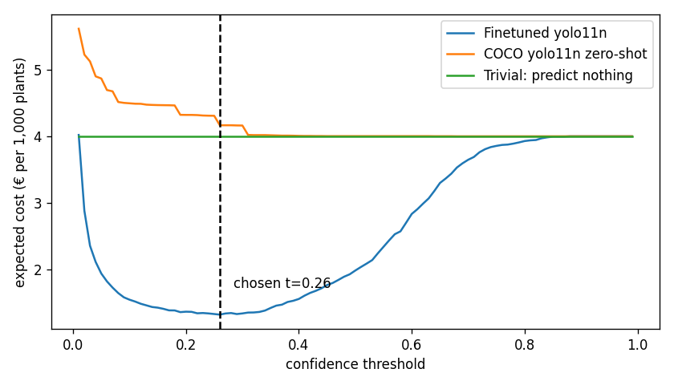

# Assignment 2 Report

- **Name**:
- **Student ID**:
- **Email**:
- **Group**: [BBADBA 5A | BBADBA 5B | PPLEDBA 5A | BDBA 3A]

## Business problem, and the cost of being wrong

**Decision.** For every plant in a field image: spray it with herbicide, leave
it, or send it to a person. Positive class = **weed** (positive means "spray").

**Who acts on it.** Today the farmer sprays the whole field with a selective
herbicide, or scouts and weeds by hand. With the model, a drone photographs the
field, the model labels each plant, an agronomist can check uncertain plants on
a tablet, and a spot sprayer executes the resulting map with a non-selective
herbicide. Review happens before spraying, so a person can check plants
without slowing the sprayer.

**What each mistake costs** (reference crop: maize; figures derived in "Cost
matrix and operating point"):

| Outcome | What happens | Cost per plant |
|---|---|---|
| False positive: crop sprayed | Non-selective herbicide kills the crop plant; its yield is lost | €0.020 |
| False negative: weed missed | Weed competes with nearby crop and adds seeds to the soil | €0.010 |
| True positive: weed sprayed | One spot dose of herbicide | €0.001 |
| True negative: crop left | Nothing | €0 |
| Spray on bare soil | Wasted dose | €0.001 |

**Asymmetry.** Spraying a crop is about **twice** as costly as missing a weed.
A killed crop plant is a certain, immediate loss. A missed weed causes a
partial, spread-out loss, and the next pass can still catch it. This should
push the spray threshold **up**: accept missing some weeds to protect crop
plants. The metric that matters most is therefore **how often a crop gets
sprayed**, not overall mAP. As the results show, this asymmetry ends up not
binding on the test set, because the model never sprays a test crop, and that
is itself the main caveat of this report.

## Dataset

- **Roboflow Universe:** workspace `object-detection`, project
  `weed-crop-aerial`, version **2**
- **Link:** https://universe.roboflow.com/object-detection/weed-crop-aerial
- **One image:** a 640×640 top-down photo of soil with young plants. Each
  plant has a bounding box labelled `crop` or `weed`.
- **Why it serves the problem.** It labels **both** crop and weed. A
  weed-only dataset could measure missed weeds but never the expensive error,
  a crop being sprayed. It is part of Roboflow 100, a curated benchmark.
- **Where it only resembles the problem.** The crop species is not named (a
  narrow-leaved seedling grown in planter trays), and the crop appears almost
  only in tray photos (see next section).

## What the dataset's composition implies

| Split | Images | Weed boxes | Crop boxes | Images with crop | Crop boxes in tray photos |
|---|---|---|---|---|---|
| Train | 823 | 5,188 | 278 | 70 | 275 |
| Valid | 235 | 1,558 | 47 | 17 | 43 |
| Test | 118 | 696 | 85 | 16 | 85 |

**Object size.** Weeds have a median of about 0.1% of the image area (roughly
20×20 px). Crops have a median of about 0.25% (roughly 32×32 px). These are
small objects, a known weakness of a nano detector.

**Interpretation.**

- **Imbalance.** 95% of training boxes are weeds, so the model sees few crops,
  the class whose errors cost most.
- **The crop numbers are too thin to trust precisely.** The test set has 85
  crop boxes in only 16 images. One image with 10 crops can move crop recall by
  about 12 points. Zero crops sprayed out of 85 is compatible with a true rate
  of up to about 3.5% (rule of three), and more given that the crops cluster in
  16 images.
- **The test split does not look like production.** Every test crop comes from
  tray photos (`IMG_…` files). The open-field photos contain only weeds. The
  model can learn "tray background = crop", and the crop-sprayed rate is never
  measured in open-field conditions.
- **The base rate differs.** The test set is 89% weeds. A planted field has
  far more crop plants, so the cost analysis uses an assumed production base
  rate of 40% weeds.
- **No leakage.** No source image appears in more than one split.

**What I cannot conclude.** That the crop-sprayed rate holds in an open field,
or that it is truly zero. Results only hold for tray-like scenes.

## Finetuning and baselines

**Model and task.** `yolo11n`, **object detection**. Detection rather than
classification because one image contains many plants and the sprayer needs a
location per plant. Nano because a drone or spot sprayer needs fast inference.

**Training.** Google Colab, T4 GPU, about 15 minutes. COCO-pretrained
weights, up to 100 epochs, early stopping with patience 25, image size 640,
batch 16, seed 0.

**Results on the test split** (decision metrics at each model's own
cost-minimising threshold):

| Model | AP50 weed | AP50 crop | Weed recall | Crops sprayed | € / 1,000 plants |
|---|---|---|---|---|---|
| **Finetuned yolo11n** | **0.744** | **0.762** | **87.8%** | **0 / 85** | **1.32** |
| COCO yolo11n zero-shot | 0.004 | 0 | 0% | 0 / 85 | 4.00 |
| Trivial: predict nothing | 0 | 0 | 0% | 0 / 85 | 4.00 |

**What changed.** The finetuned model cuts expected cost by **67%** against
both baselines (€4.00 → €1.32 per 1,000 plants; bootstrap 95% CI €1.20–1.49).
COCO has no crop or weed class, so I treated any COCO detection as "spray". It
detects almost nothing useful, and at low thresholds it is **worse than doing
nothing**, because it sprays bare soil. Its best threshold simply means
"never spray", so it collapses to the trivial baseline. The gap is as large as
expected: COCO has never seen weed seedlings this small.

## Per-class evaluation and failure modes

| Class | Precision | Recall | AP50 | mAP50-95 |
|---|---|---|---|---|
| weed | 0.703 | 0.757 | 0.745 | 0.438 |
| crop | 0.707 | 0.753 | 0.760 | 0.458 |
| **all (headline)** | | | **0.752** | **0.448** |

**Headline.** Weed carries the headline number in practice, with 89% of test
boxes. The two classes score almost the same, so neither is dragging the
average.

**Confusion matrix** (Ultralytics, rows predicted, columns true):

| Predicted \ True | crop | weed | background |
|---|---|---|---|
| crop | 81 | 0 | 1,522 |
| weed | 0 | 688 | 10,755 |
| background (missed) | 4 | 8 | – |

The background column is computed at Ultralytics' validation confidence of
0.001, so it counts every low-confidence box. At the chosen threshold, sprays
on bare soil are 379, about 0.49 per plant.

**Where it breaks:**

- **Crop and weed are never confused:** 0 in both directions. The highest
  weed score on any test crop is 0.02. This looks perfect, but every test crop
  is in a tray photo, so the model may be using the tray background as a cue.
  This is the error that matters most and it is untested in open field.
- **Missed weeds are the real failure:** at t = 0.26, 85 of 696 weeds (12%)
  are not sprayed. These are the small ones; weed localisation is loose
  (mAP50-95 0.44 vs AP50 0.74).
- **Field photos are harder:** weed recall is 93% in tray photos but 87% in
  open-field photos, where weeds are smaller and the soil is more varied.
- **False detections on soil:** 379 sprays on bare soil. Cheap at €0.001
  each, but this is wasted herbicide.

## Cost matrix and operating point

**Where each figure comes from** (assumptions, reference crop maize):

- **Value of one crop plant.** Maize yields about 10 t/ha at about €200/t, so
  roughly €2,000/ha, over about 80,000 plants/ha, giving about €0.025 per
  plant.
- **FP, crop sprayed: €0.020.** The plant's value minus some compensation, as
  neighbouring plants grow into the gap, plus one wasted dose.
- **FN, weed missed: €0.010.** Yield lost to competition plus future seed
  bank. This is the least certain figure.
- **TP, weed sprayed: €0.001.** One spot dose. **Soil spray: €0.001.**
- **Base rate: 40% weeds**, a moderately infested field after planting,
  instead of the dataset's 89%.

**Sweep.** Every threshold from 0.01 to 0.99 is costed per 1,000 plants:

**Chosen operating point: t = 0.26**, at **€1.32 per 1,000 plants** (bootstrap
95% CI €1.20–1.49). The curve is flat between about 0.19 and 0.33 (all within
€0.04 of the minimum), so the choice is robust to small changes.

**Why so low, given that crop sprays cost twice as much.** No test crop scores
above 0.02, so raising the threshold protects no crops; it only loses weeds.
Below the threshold, the only trade-off left is a missed weed (€0.010) against
a spray on bare soil (€0.001). That favours spraying generously.

**The assumption that would most change the answer** is that crops are never
confused with weeds, which comes from tray photos only. The sensitivity table
(`artifacts/sensitivity.csv`) shows how the threshold moves with the cost
inputs:

| FN cost (weed missed) | 20% weeds | 40% weeds | 60% weeds |
|---|---|---|---|
| €0.002 | 0.70 | 0.53 | 0.49 |
| €0.005 | 0.41 | 0.33 | 0.32 |
| **€0.010 (chosen)** | 0.33 | **0.26** | 0.19 |
| €0.020 | 0.26 | 0.14 | 0.10 |

If a missed weed were worth only €0.002, the threshold would double to 0.53.
If crops started getting confused in the field, the threshold would also have
to rise, by an amount this test set cannot measure.

## What a person still has to check

**The sweep's answer is: no plant-level review.** Searching every pair
(t_low, t_high) for the minimum cost gives an empty band, t_low = t_high =
0.26, so every plant is either sprayed or left.

**Why review does not pay:**

- One check costs about €0.014 (2.5 s at €20/h). Reviewing a weed can save at
  most €0.009 (a missed weed minus a dose), so reviewing weeds always loses
  money.
- Reviewing only pays for crops near the threshold, and there are none: no
  crop scores above 0.02.
- The plants near the threshold are mostly **false detections on bare soil**,
  which would take most of the reviewer's time for a €0.001 saving each.
- Even at 0.3 s per check (€0.0017) the optimal band stays empty.

**Volume and people.** The drone covers 20 ha/day × 80,000 crop plants/ha ÷
60% crop share, about **2.7 million plants/day**. One reviewer working 8 h at
2.5 s per check can do about 11,500 checks, **0.43% of plants**. Even the
narrowest band I tested would overwhelm that:

| Band | Share reviewed | Checks/day | Reviewers needed | € / 1,000 plants |
|---|---|---|---|---|
| none (chosen, 0.26) | 0% | 0 | 0 | 1.32 |
| 0.20 – 0.26 | 14.2% | 378,000 | 33 | 3.20 |
| 0.15 – 0.26 | 31.1% | 830,000 | 72 | 5.46 |

A per-plant review band is not realistic at this scale.

**What the person should do instead: audit the field.** The real risk is the
one the test set could not measure, crops sprayed in open-field conditions. So
the agronomist's time goes into checking a random sample of about 50 image
tiles per day before the sprayer runs (about 30 s each, 25 minutes in total),
recording any crop the model marks for spraying. This fits within one person,
measures the costly error where it actually happens, and tells us whether the
threshold must rise.

**Priced against the alternatives** (per 1,000 plants, and per day over 20
ha):

| Policy | € / 1,000 plants | € / day | People needed |
|---|---|---|---|
| Do nothing (never spray) | 4.00 | ≈ 10,700 | 0 |
| Spray every plant | 12.40 | ≈ 33,100 | 0 |
| Person checks every plant | 14.29 | ≈ 38,100 | ≈ 230 |
| **Model alone (t = 0.26) + field audit** | **1.32** | **≈ 3,500** | **1 (part-time audit)** |

The model alone is about €7,100 a day cheaper than doing nothing over 20 ha.
A person checking every plant is the most expensive option, because the
checking alone costs more than all the weeds it would catch.

## Limitations & next steps

- **Crop only in tray photos, so the costly error is untested in the field.**
  Collect and label open-field images that contain the crop, and rerun the
  sweep. Until then, run the field audit described above.
- **Thin crop test set** (85 boxes in 16 images). Zero crops sprayed could
  still mean up to about 3.5%. Add crop images, and report intervals by image,
  not by box.
- **12% of weeds missed, mostly the smallest.** Try image size 960, tiling, or
  `yolo11s`, and check whether recall on small weeds improves.
- **Many false detections on soil** (0.49 per plant at t = 0.26). Cheap now,
  but costly with expensive herbicide. Raising the soil-spray cost in
  `costing.py` would push the threshold up.
- **Assumed costs.** Validate plant value, weed damage and review time with an
  agronomist, and fix the actual crop species.

## Generative AI use disclosure

*Describe what you used and how.*
